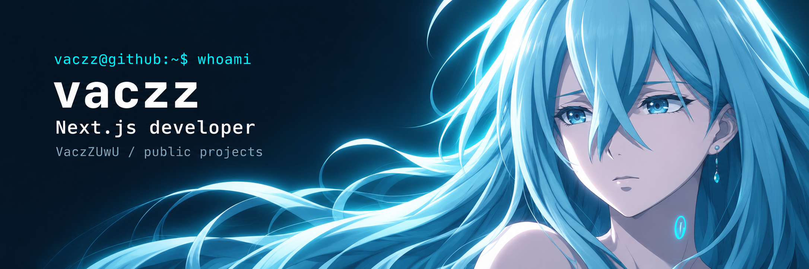
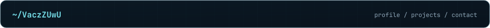
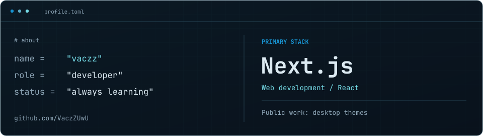
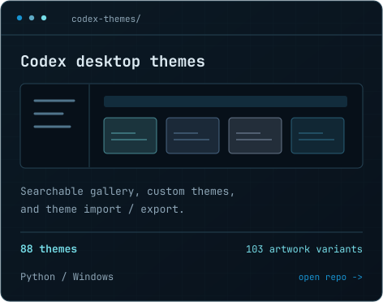
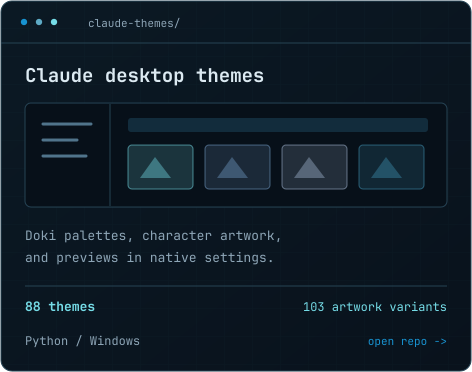
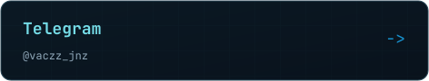
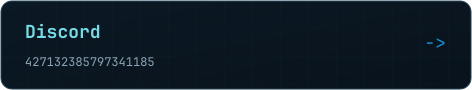
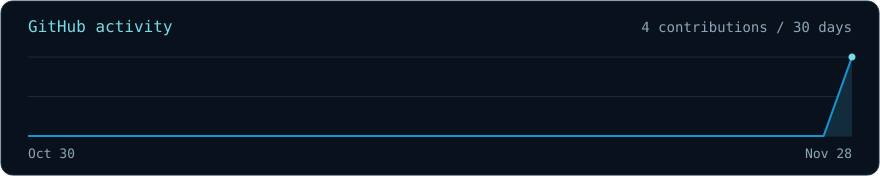

<!-- vaczz / Vivy palette / terminal typography -->

Activity &amp; contributions

Text version &amp; project links

## vaczz

Developer · always learning. **Main stack: Next.js.**

### Public work

- [Codex Themes](https://github.com/VaczZUwU/codex-themes) — Doki palettes, artwork, searchable gallery, custom themes with import/export.
- [Claude Themes](https://github.com/VaczZUwU/claude-themes) — Doki palettes, character wallpapers and a native preview gallery.

These public projects use Python and target Windows. Both are unofficial and experimental. Each project documents 88 themes and 103 artwork variants; these are project contents, not GitHub activity metrics.

[Telegram](https://t.me/vaczz_jnz) · [Discord](https://discord.com/users/427132385797341185) · [All repositories](https://github.com/VaczZUwU?tab=repositories)

Vivy-inspired fan artwork. Character rights belong to their respective owners. Typography: JetBrains Mono, SIL Open Font License.

